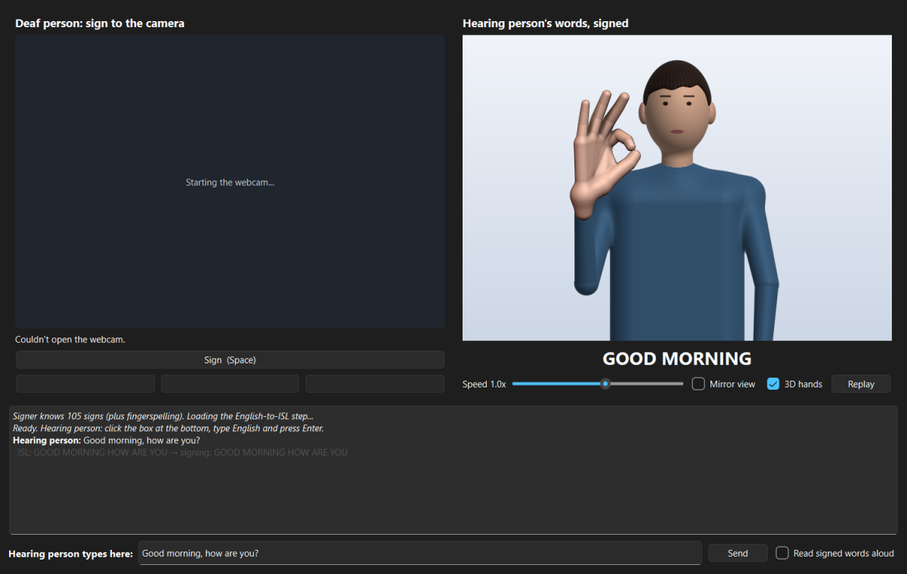

# Text to sign, and the two-way ISL app

This folder joins Kunal's text-to-sign pipeline with our sign-to-text BiLSTM, so a deaf person
and a hearing person can talk in one window:

- **Deaf person → text:** sign to the webcam. Our BiLSTM shows its top 3 guesses, you pick one,
  and it goes into the conversation (and can be read aloud).
- **Hearing person → signs:** type English. Kunal's `nlp_tool.py` turns it into ISL gloss
  (ISL word order), and a 3D signer signs it. Words we have no recording for are fingerspelled.
  Type a name in square brackets, e.g. `[Manan]`, to spell it.



## Run it (Windows)

Double-click `start_app.bat`, or:

```
.venv\Scripts\python isl_app.py
```

Options: `--camera 1` (another webcam), `--speed 0.8` (slower signing), `--mirror` (show the
signer like a mirror), `--model path\to\model.pt`.

### Setup (once)

In this folder, make a venv that can still see torch, MediaPipe, PySide6 and PyOpenGL, and add spaCy:

```
python -m venv --system-site-packages .venv
.venv\Scripts\pip install spacy PySide6 PyOpenGL
.venv\Scripts\python -m spacy download en_core_web_sm
```

The webcam side loads `mpipe.py`, `isl_model/` and a model from the repo folder above this one.
It uses `runs/all_position_big/model.pt` if it's there, otherwise `models/include_position.pt`.

## How the signer works

| File | What it does |
|---|---|
| `isl_app.py` | The window: webcam and guesses on the left, the signer on the right, the conversation and the typing box at the bottom |
| `signer.py` | Sign data and playback. Places every sign relative to the face, so all signs share one body and size; smooths the landmarks, keeps finger lengths steady, and blends from one sign to the next |
| `signer_view.py` | Draws the signer (head, hair, body, arms solved in 3D) with OpenGL |
| `hand3d.py` | The 3D hand: real finger thickness, a palm that turns with the hand, lighter palm side, nails |
| `hand_renderer.py` | Kunal's hand shader and data loaders from `renderer.cpp`, ported to Python (the "3D hands" checkbox off) |
| `build_signs.py` | Builds `signs.npz` from our recorded takes: picks the cleanest take of each word |
| `signs.npz` | The signer's vocabulary: 91 signs from our recordings (INCLUDE + our webcam takes), as hand landmarks only |
| `test_signer_app.py` | Opens the app without the webcam, types a few sentences and saves screenshots |

Kunal's words in `words_kunal_original.data` (21 entries, 19 real words plus two test entries) and his letters in `alphabets.data` are used for
anything `signs.npz` doesn't have. His alphabet is 2D only, so some letters look rough, and
H, S, W and Y have no shape yet (the caption names the letter).

To rebuild `signs.npz` after recording more takes (each take needs `hands_screen.npy`, and
ideally `hands.npy` and `face_coords.npy`):

```
.venv\Scripts\python build_signs.py ..\..\dataset_include_positions ..\..\dataset_include_more ..\..\dataset_mmkay_webcam --pick I=..\..\dataset_include_positions\i\seq_017
```

## Kunal's original pipeline

| File | What it does |
|---|---|
| `nlp_tool.py` | English sentence to ISL gloss (spaCy), e.g. "I ate an apple yesterday" → `YESTERDAY I APPLE EAT` |
| `renderer.cpp` | Kunal's OpenGL hand renderer (with smoothing added). `renderer_kunal_original.cpp` is his untouched version |
| `words.data`, `words_kunal_original.data`, `alphabets.data` | Hand animations: 63 words (his 21 + ours) / his original 21 / static letters |
| `server.cpp`, `client.cpp`, `Makefile`, `run.sh` | His Linux chat version |

The older three-window version still works: `chat_server.py`, `chat_client.py` and
`takes_to_words.py`, with `renderer.exe` built by `build_renderer.bat` (needs MSYS2 with glfw and glew),
or the one-window Tk version `start_chat.bat`.

## Data credit

Signs from the INCLUDE dataset (AI4Bharat), CC BY 4.0: A. Sridhar, R. G. Ganesan, P. Kumar and
M. Khapra, "INCLUDE: A Large Scale Dataset for Indian Sign Language Recognition", ACM Multimedia 2020.
